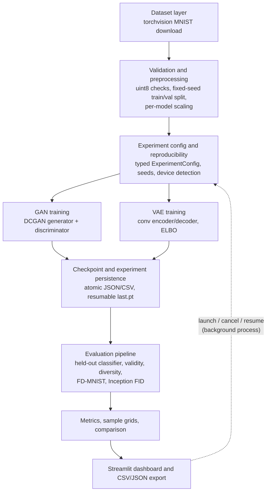

# GenAI Solution Lab: Generative Model Training, Evaluation and Solution Architecture

An end-to-end, reproducible experimentation platform that **implements, trains, evaluates and compares two
generative model families** on MNIST: a **GAN** (DCGAN-style) and a **VAE** (convolutional). It is built
with Python and PyTorch, and includes a Streamlit dashboard for running experiments and presenting results.

> Scope and honesty note: this is a personal portfolio project. The models are small networks trained from
> scratch on MNIST. They are not pretrained foundation models, are not comparable to LLMs, and have not
> been deployed commercially or used by customers. Every metric in this repository and dashboard is computed
> from an actual run. None are hand-entered.

---

## Contents

- [Problem statement and motivation](#problem-statement-and-motivation)
- [Features](#features)
- [Architecture and data flow](#architecture-and-data-flow)
- [Technical stack](#technical-stack)
- [Mathematical overview](#mathematical-overview)
- [Installation (Windows PowerShell)](#installation-windows-powershell)
- [CUDA verification](#cuda-verification)
- [Training commands](#training-commands)
- [Dashboard](#dashboard)
- [Docker deployment](#docker-deployment)
- [Automated tests](#automated-tests)
- [Evaluation methodology](#evaluation-methodology)
- [Results](#results)
- [Known limitations](#known-limitations)
- [Troubleshooting](#troubleshooting)
- [Future improvements](#future-improvements)
- [Mapping to the BytePlus Generative AI Solution Architect Intern role](#mapping-to-the-byteplus-generative-ai-solution-architect-intern-role)

## Problem statement and motivation

Choosing a generative approach for a product means trading off sample fidelity, coverage of the data
distribution, training stability, controllability and how hard results are to evaluate. These trade-offs are
easy to state and hard to show. This lab makes them concrete. It trains both a GAN and a VAE under one
reproducible protocol, evaluates them with one leakage-free metric pipeline, and presents the results so an
engineer or a business stakeholder can follow them.

**Why GAN vs. VAE?** They are the two classic generative families with opposite philosophies. A GAN learns
through an adversarial game, which tends to give sharp samples but unstable training and possible mode
collapse, and it has no encoder. A VAE maximises a likelihood bound, which gives stable training, an
encoder and a smooth latent space, but blurrier samples. The same comparison sits under the more modern
choices between GAN-, VAE-, flow- and diffusion-based systems.

## Features

- **Two real generative models in PyTorch**: DCGAN-style generator and discriminator; convolutional VAE with
  the reparameterisation trick, Bernoulli reconstruction loss and closed-form KL.
- **Leakage-free data pipeline**: automatic MNIST download, a fixed-seed 55k/5k train/validation split, and
  the official test set isolated. `train_limit` for quick runs. Per-model normalisation. Input validation
  with actionable errors.
- **Reproducible experiments**: typed, validated `ExperimentConfig`; full seeding with deterministic kernels;
  separate RNG streams for batching, fixed grids and evaluation. Resume reproduces uninterrupted runs on CPU
  (tested).
- **Training telemetry**: per-epoch losses, D(x) and D(G(z)) diagnostics, train and validation ELBO terms,
  per-epoch sample grids from fixed noise, VAE reconstruction grids, elapsed time, Matplotlib training curves.
- **Evaluation pipeline**: held-out classifier (trained on the training split, selected on validation, tested
  once on the test set), validity rate with a documented threshold and a real-data reference, class entropy,
  pixel and feature diversity ratios, **standard FID** (pytorch-fid Inception weights) and a labelled
  **FD-MNIST** alternative, runtime and device.
- **Persistence**: one self-contained directory per experiment, with atomic writes, resumable checkpoints,
  `metrics.csv` + `metadata.json` downloads, and history that survives dashboard restarts.
- **Background jobs**: training runs in a detached process. One job at a time; start, monitor, cancel, force
  stop, and resume after a crash or cancellation.
- **Dark Streamlit dashboard** with seven pages: Overview, Dataset explorer, Train models, Generated samples
  (including live sampling and latent interpolation), Evaluation, Experiment comparison, and
  Architecture and documentation.
- **98 automated tests** (pytest) on synthetic data, including headless rendering of every dashboard page.

## Architecture and data flow



```
genai-solution-lab/
├── app.py                     # Streamlit entry point (st.navigation)
├── cli.py                     # CLI: env, download-data, train, resume, evaluate, list, export, test
├── app_pages/                 # one script per dashboard page
├── src/
│   ├── data/                  # dataset.py (download, split, loaders), preprocessing.py
│   ├── models/                # gan.py, vae.py
│   ├── training/              # trainer.py (loops), experiment.py (orchestration), jobs.py (background jobs)
│   ├── evaluation/            # classifier.py, metrics.py, fid.py, evaluate.py, plots.py
│   ├── persistence/           # storage.py (experiment store, atomic I/O)
│   ├── utils/                 # config.py, reproducibility.py, logging_utils.py
│   └── ui/                    # helpers.py (pure, tested), components.py (Streamlit)
├── tests/                     # pytest suite (synthetic data; no downloads)
├── docs/                      # architecture.md, methodology.md, evaluation.md
├── outputs/                   # experiments/<id>/..., evaluator/ (git-ignored contents)
└── data/                      # MNIST (downloaded; git-ignored)
```

Each experiment lives in `outputs/experiments/<model>-<YYYYMMDD>-<HHMMSS>-<hex>/`, containing `config.json`,
`status.json`, `job.json`, `history.csv`, `metrics.json`, `metrics.csv`, `metadata.json`, `train.log`,
`samples/*.png` and `checkpoints/last.pt`. Details, the failure-handling matrix and trade-offs are in
[docs/architecture.md](docs/architecture.md).

## Technical stack

| Purpose | Library |
|---|---|
| Models, training | PyTorch, torchvision |
| Standard FID | pytorch-fid (Inception-v3 TF FID weights), SciPy `sqrtm` |
| Evaluator metrics | scikit-learn (classification report, confusion matrix) |
| Data | NumPy, pandas, Pillow |
| Plots | Matplotlib (saved figures), Altair (interactive dashboard charts) |
| UI | Streamlit ≥ 1.64 |
| Tests | pytest, `streamlit.testing.v1.AppTest` |

## Mathematical overview

**GAN.** The discriminator D minimises `BCE(D(x), 1−s) + BCE(D(G(z)), 0)`, with one-sided label smoothing
`s = 0.1`. The generator G minimises the non-saturating loss `−log σ(D(G(z)))`, with `z ~ N(0, I)`.
Optimiser: Adam, lr 2e-4, β = (0.5, 0.999).

**VAE.** It minimises the negative ELBO

```
L(x) = E_{q(z|x)}[−log p(x|z)] + β · KL(q(z|x) ‖ N(0, I)),     z = μ + σ ⊙ ε,  ε ~ N(0, I)
```

The reconstruction term is Bernoulli BCE summed over 784 pixels. The KL term is
`−½ Σ (1 + log σ² − μ² − σ²)` summed over latent dimensions. Both are averaged over the batch, giving
nats per image.

The **trade-off**: reconstruction pushes z to carry as much information as possible, while KL pulls every
posterior toward the prior. A larger β gives a smoother, more sample-able latent space but blurrier
reconstructions, and can cause posterior collapse. A smaller β gives sharper reconstructions but "holes"
in the latent space. Full derivations and design choices: [docs/methodology.md](docs/methodology.md).

## Installation (Windows PowerShell)

```powershell
cd C:\Users\<you>\genai-solution-lab
python -m venv .venv
.\.venv\Scripts\Activate.ps1          # if blocked: Set-ExecutionPolicy -Scope CurrentUser RemoteSigned

# Option A, CPU only (works everywhere):
pip install torch torchvision --index-url https://download.pytorch.org/whl/cpu
# Option B, NVIDIA GPU: pick the CUDA build for your driver at https://pytorch.org/get-started/locally/
# e.g.  pip install torch torchvision --index-url https://download.pytorch.org/whl/cu124

pip install -r requirements.txt
python cli.py download-data           # ~12 MB into .\data
```

Tested on Windows 11 with Python 3.11.9, torch 2.14.1+cpu, torchvision 0.29.1+cpu and streamlit 1.64.0.

## CUDA verification

```powershell
python cli.py env
python -c "import torch; print(torch.__version__, torch.cuda.is_available(), torch.version.cuda)"
nvidia-smi                            # driver and GPU visible to Windows?
```

The code uses CUDA automatically when `torch.cuda.is_available()` is `True`, and the CPU otherwise. The
selected device appears in the dashboard sidebar and in every experiment's `metadata.json`. `--device cuda`
fails loudly when CUDA is unavailable; it never silently falls back. A version string ending in `+cpu`
means a CPU-only wheel is installed.

## Training commands

```powershell
python cli.py train-classifier                        # once: held-out evaluator
python cli.py train --model gan --epochs 2 --train-limit 10000 --eval-samples 1000 --fid-samples 1000   # quick
python cli.py train --model vae --epochs 2 --train-limit 10000 --eval-samples 1000 --fid-samples 1000
python cli.py train --model gan --epochs 10           # full training split, defaults
python cli.py train --model vae --epochs 10 --kl-weight 4.0 --no-fid
python cli.py resume   --experiment-id <id>           # continue a cancelled/interrupted run
python cli.py evaluate --experiment-id <id>           # recompute metrics from the checkpoint
python cli.py list
python cli.py export --output results.csv             # all metrics, one CSV
```

Other options: `--batch-size`, `--latent-dim`, `--lr`, `--seed`, `--label-smoothing` (GAN), `--kl-weight`
(VAE), `--device {auto,cpu,cuda}`. Invalid settings are rejected with every problem listed, for example
`train_limit (50) must be >= batch_size (128)`.

## Dashboard

```powershell
streamlit run app.py      # http://localhost:8501
```

| Page | What it shows |
|---|---|
| Overview | Model cards (live parameter counts), architecture diagram, dataset summary, latest experiment status and real metrics |
| Dataset explorer | Real MNIST previews by split and digit, class distributions, preprocessing table, live train/val overlap check |
| Train models | Model and preset selection, validated form, live progress, losses, sample grid and log; cancel, force stop, resume, delete; duplicate-job lock |
| Generated samples | Grids across epochs (fixed noise), VAE reconstructions, real vs. generated, live sampling and latent interpolation from checkpoints, PNG export |
| Evaluation | Model objective, proxy metrics with real-data references, FID, runtime, evaluator accuracy (labelled), software-test results on a separate tab, metric definitions, CSV/JSON/PNG downloads |
| Experiment comparison | Config diff with fairness warnings, comparable-metrics table with directions, per-model curves, samples, runtime, number-based interpretation, CSV export |
| Architecture and documentation | Diagram plus the rendered docs |

Training runs in a separate process, so you can browse other pages, refresh or close the browser while a
job runs. Reopening the dashboard picks the job back up.

## Docker deployment

The repository ships a CPU-only image that runs the dashboard and the CLI. Training jobs started from the
dashboard run inside the same container.

```powershell
docker compose up --build -d                          # http://localhost:8501
docker compose exec lab python cli.py download-data   # optional: the dashboard can also trigger it
docker compose exec lab python cli.py train-classifier
docker compose exec lab python cli.py train --model vae --epochs 2 --train-limit 10000
docker compose logs -f lab
docker compose down                                   # add -v to also delete data and experiments
```

State lives in three named volumes, so it survives rebuilds and restarts: `lab-data` (MNIST),
`lab-outputs` (experiments, checkpoints, evaluator) and `lab-torch-cache` (Inception weights for FID).
To copy results to the host: `docker compose cp lab:/app/outputs ./outputs-docker`.

Without Compose:

```powershell
docker build -t genai-solution-lab .
docker run -d --init -p 8501:8501 -v lab-data:/app/data -v lab-outputs:/app/outputs `
  -v lab-torch-cache:/app/.cache/torch --name genai-lab genai-solution-lab
```

The image installs the CPU PyTorch wheel. For a GPU you would need a CUDA base image, the CUDA wheel and the
NVIDIA Container Toolkit (`--gpus all`); that setup is not included or tested here.

## Automated tests

```powershell
python -m pytest -q          # full suite
python cli.py test           # same, plus a JUnit report the dashboard's Evaluation > Software tests tab reads
```

The suite uses synthetic tensors and temporary directories only. It does not download MNIST or touch
`outputs/`. It covers model shapes and output ranges, VAE loss maths (closed-form KL, reduction convention)
and gradient flow, split isolation and nested `train_limit`, loader reproducibility, config validation
(14 invalid cases), atomic persistence and corruption handling, checkpoint round trips, seeded
reproducibility, resume equivalence, cancellation, divergence detection, the end-to-end pipeline with stubbed
data, failure recording, job-liveness and duplicate-launch protection, UI helper functions, and headless
rendering of all seven pages. **Software test results are not model metrics.**

## Evaluation methodology

Summary (full details: [docs/evaluation.md](docs/evaluation.md)):

| Metric | Kind | Comparable across models | Better |
|---|---|---|---|
| GAN D/G loss, D(x), D(G(z)) | Objective / diagnostic | No | n/a |
| VAE reconstruction, KL, −ELBO (train and validation) | Objective | No | lower recon / ELBO |
| Validity rate (top softmax ≥ 0.9, held-out classifier) | Proxy | Yes | higher (ceiling = real-data value) |
| Class entropy (normalised) | Proxy | Yes | closer to the real-data value (about 1) |
| Diversity ratio (pixel and classifier features) | Proxy | Yes | closer to 1 |
| FD-MNIST (Fréchet distance on classifier features; **not standard FID**) | Proxy | Yes, within this project | lower |
| FID (pytorch-fid Inception-v3, N = `fid_num_samples`) | Distribution | Yes, at equal N | lower |
| Train and eval seconds, device | Runtime | Context only | n/a |

Evaluation samples use seed `seed + 10000`. The real reference is the **validation split**, which is never
used for generative training. The test set is used only once, for the evaluator classifier's accuracy.

## Results

<!-- RESULTS:START -->
All numbers below were produced by the runs listed, read from each experiment's `metrics.json`. They come
from **one seed per model** on a **CPU-only laptop** (Intel64 Family 6 Model 186, 10 torch threads,
torch 2.14.1+cpu, Windows 11).

**Main comparison**: identical settings for both models. Full 55,000-image training split, 5 epochs,
batch 128, seed 42, model-default architecture and optimiser, 2,000 evaluation samples, FID at N = 1,000
against 1,000 validation images, validity threshold 0.9.

| Metric | GAN `gan-20261027-005603-53ebb9` | VAE `vae-20261027-184140-a927e7` | Real validation data | Better |
|---|---|---|---|---|
| Validity rate (top-class prob ≥ 0.9) | **0.576** | 0.502 | 0.970 | higher |
| Mean top-class confidence | **0.851** | 0.814 | n/a | higher |
| Class entropy (normalised) | 0.953 | **0.989** | 0.999 | closer to real |
| Digit classes covered | 10 / 10 | 10 / 10 | 10 / 10 | n/a |
| Diversity ratio, classifier features | **0.840** | 0.678 | 1.0 by definition | closer to 1 |
| Diversity ratio, pixels | **1.005** | 0.818 | 1.0 by definition | closer to 1 |
| FD-MNIST (classifier features; not standard FID) | **132.2** | 203.7 | n/a | lower |
| FID (Inception-v3, N = 1,000) | 44.45 | **40.95** | n/a | lower |
| Training time | 44m 18s | 15m 04s | n/a | context only |
| Evaluation time (incl. FID) | 17m 31s | 3m 41s | n/a | context only |

Model-specific objectives (not comparable across models):

* **GAN** final epoch: D loss 0.881, G loss 1.696, mean D(x) 0.659, mean D(G(z)) 0.241. Both moved steadily
  toward balance across the 5 epochs, with no divergence or discriminator collapse.
* **VAE** final epoch, validation split: reconstruction 80.57 nats/image (0.103 per pixel),
  KL 21.80 nats/image, −ELBO 102.37. Training −ELBO was 103.23, close to validation, so there is no sign of
  overfitting.

**Evaluator classifier** (used by the proxy metrics; this is *its* accuracy, not a generative-model
accuracy): validation 98.92%, held-out MNIST test **99.11%**.

**What the numbers say, and what they don't:**

* The two metric families **disagree**. The classifier-based proxies favour the GAN: higher validity,
  lower FD-MNIST, and spread closer to real data. Standard FID slightly favours the VAE (40.95 vs. 44.45).
  The sample grids are consistent with both readings. GAN samples are sharp but include malformed strokes.
  VAE samples are smoother and lower-contrast, with fewer artefacts. ImageNet-Inception features plausibly
  penalise the GAN's high-frequency artefacts more than the VAE's blur. That explanation is a hypothesis
  and was not tested here.
* The VAE covers digit classes more evenly (entropy 0.989 vs. 0.953). The GAN over-produces some digits
  (400 of 2,000 predicted as "9") and under-produces others (80 predicted as "4"), a mild mode imbalance.
* The VAE's pixel diversity ratio of 0.82 is consistent with blur. Averaged, low-contrast images sit
  closer together in pixel space.
* With one seed and a 3.5-point FID gap at N = 1,000, the FID difference should be treated as
  **inconclusive** until it is repeated over several seeds.
* **Runtime caveat:** both runs shared the CPU with unrelated applications under heavy memory pressure.
  GAN epochs 1–2 took about 900 s each, while epochs 3–5 took 260–300 s once the load eased. The VAE ran at
  below-normal priority. The GAN's evaluation was re-run after an interruption. Training was not repeated,
  and the recomputed proxy metrics matched the interrupted run's to all printed digits. Treat the times as
  rough indications, not benchmarks.

**Smoke runs** (2 epochs, 10,000 training images, 1,000 evaluation samples; they verify the pipeline
end-to-end and are not tuned): GAN validity 0.074, FD-MNIST 726.4, FID 318.0; VAE validity 0.000,
FD-MNIST 1360.1, FID 260.4. The VAE was still producing an "average digit" blur at that point (KL 2.6
nats/image), so the classifier was never confident. That is real early-training behaviour, not a bug: the
same code reached 0.502 after 5 full epochs.

**Software tests** (code correctness, not model quality): `python cli.py test` → **98 passed, 0 failed**
(47–59 s across runs). A headless render of all seven dashboard pages against these real experiments raised 0 exceptions.
<!-- RESULTS:END -->

## Known limitations

- **CPU-bound development**: the results above come from a laptop CPU. GAN training took 4–15 min
  per full epoch (depending on background load), and FID about 3.5–16 min per 1,000 images, depending on background load. With a CUDA GPU, both are much faster.
- **Single seed per configuration**: no variance estimate. Small metric differences may be noise.
- **FID on MNIST**: ImageNet Inception features are a poor fit for digits. N = 1,000 is below the 2,048
  feature dimension (rank-deficient covariance, upward bias). Values are comparable only within this
  project at equal N.
- **Proxy metrics depend on one classifier**: validity and FD-MNIST inherit its biases and can be gamed by
  prototypical digits. Read them together with the diversity metrics and the sample grids.
- **MNIST** is simple and centred. Results do not transfer to natural images or production data.
- **Single-user, single-machine** job management (file-based, one job at a time), by design.

## Troubleshooting

| Symptom | Fix |
|---|---|
| `DatasetUnavailableError: MNIST not found` | `python cli.py download-data`; behind a proxy, set `HTTPS_PROXY` or copy the raw MNIST files to `data\MNIST\raw` |
| FID shows `unavailable` | The Inception weights (~92 MB) download from GitHub on first use. Check network access, or run with `--no-fid` (FD-MNIST is still computed) |
| `CUDA was requested but ... False` | A CPU wheel is installed. Reinstall torch from the CUDA index (see Installation) and check `nvidia-smi` |
| `experiment ... is still running` | One job at a time. Wait, or cancel it on the Train models page |
| Job shows `interrupted` | The process died (reboot or crash). Click **Resume from checkpoint**, or run `python cli.py resume --experiment-id <id>` |
| GAN `failed` with "non-finite loss" | Training diverged. Start a new run with a lower `--lr` (e.g. 1e-4) or more `--label-smoothing` |
| `Activate.ps1 cannot be loaded` | `Set-ExecutionPolicy -Scope CurrentUser RemoteSigned` |
| `LinAlgWarning: Matrix is singular` during evaluation | Expected when the sample count is below the feature dimension, or when a ReLU feature is always zero. The value is still computed and checked for a large imaginary component |
| Port 8501 in use | `streamlit run app.py --server.port 8502` |

## Future improvements

Multi-seed runs with confidence intervals; conditional (class-aware) GAN/VAE; WGAN-GP or spectral
normalisation; β-VAE sweeps; generative precision/recall and KID; Fashion-MNIST and CIFAR-10 behind the
same data interface; a job queue for multi-user or GPU scheduling.

## Mapping to the BytePlus Generative AI Solution Architect Intern role

| Role expectation | Where this project shows it |
|---|---|
| Generative model development | GAN and VAE implemented from scratch: `src/models/`, `src/training/trainer.py` |
| Python and PyTorch | Typed, modular package; custom training loops, checkpointing, seeded generators |
| Data preparation and preprocessing | `src/data/`: leakage-free splits, validation, per-model normalisation, Dataset explorer page |
| Model training and testing | Background training jobs with resume and cancellation; 98 pytest tests, including reproducibility and resume equivalence |
| Quantitative evaluation | Held-out evaluator, validity, diversity, FID and FD-MNIST, with clear separation of objective, proxy and runtime metrics: `docs/evaluation.md` |
| AI solution architecture | Layered architecture, persistence and concurrency model, failure-handling matrix: `docs/architecture.md` |
| Technical research and documented trade-offs | GAN vs. VAE methodology, FID limitations on MNIST, design trade-off table |
| Communicating with engineers and stakeholders | Dashboard for live demos: model cards, plain-language metric definitions, fairness warnings, number-based comparison text |

This project shows the skills above at portfolio scale. It does not claim professional experience,
production deployment or customer impact.
