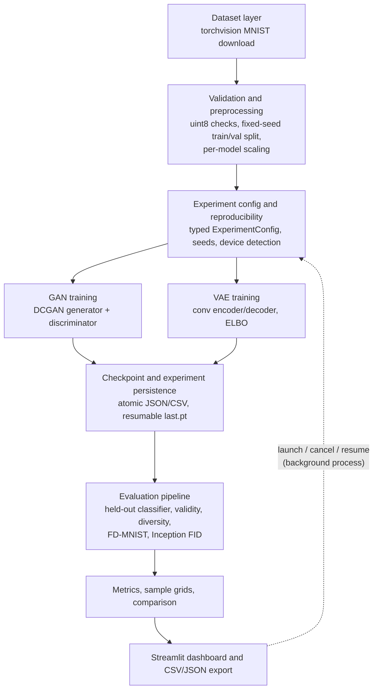

# Architecture

GenAI Solution Lab is a single-machine Python application with four layers: a **library** (`src/`), a
**CLI** (`cli.py`), **background training jobs** (`python -m src.training.experiment`), and a **Streamlit
dashboard** (`app.py`, `app_pages/`). Every layer uses the same library code, so the CLI and the dashboard
train, evaluate and persist identically.

## Module map

| Layer | Module | Responsibility |
|---|---|---|
| Configuration | `src/utils/config.py` | Paths (overridable via `GENAI_LAB_DATA_DIR` / `GENAI_LAB_OUTPUT_DIR`), `ExperimentConfig` dataclass with per-model defaults, and validation that reports *every* problem at once (`ConfigError`) |
| Reproducibility | `src/utils/reproducibility.py` | `set_seed` (Python/NumPy/PyTorch, deterministic kernels), isolated `torch.Generator` streams, CUDA/CPU detection, environment capture |
| Logging | `src/utils/logging_utils.py` | Console + per-experiment `train.log` |
| Data | `src/data/dataset.py` | MNIST download/load, fixed-seed train/val split, `train_limit`, seeded `DataLoader`s that convert uint8 to float per batch |
| Preprocessing | `src/data/preprocessing.py` | `[0,1]` / `[-1,1]` scaling, input validation (`DataValidationError`) |
| Models | `src/models/gan.py`, `src/models/vae.py` | DCGAN-style generator/discriminator; convolutional VAE with reparameterisation and loss functions |
| Training | `src/training/trainer.py` | GAN and VAE loops, per-epoch grids, resumable checkpoints, cancellation, divergence detection, sampling helpers |
| Orchestration | `src/training/experiment.py` | config → data → train → evaluate → persist; status/state machine; re-evaluation |
| Jobs | `src/training/jobs.py` | Detached subprocess launch, one-job-at-a-time lock, cancellation, force stop, crash detection |
| Evaluation | `src/evaluation/{classifier,metrics,fid,evaluate,plots}.py` | Held-out classifier, metric maths, FID/FD-MNIST, evaluation pipeline, Matplotlib figures |
| Persistence | `src/persistence/storage.py` | Experiment directory layout, atomic writes, validated IDs, summaries, CSV flattening |
| UI | `src/ui/helpers.py` (pure), `src/ui/components.py` (Streamlit), `app_pages/*.py` | Dashboard |

## Data flow for one experiment

1. **Create**: the UI or CLI builds an `ExperimentConfig`, which validates it, then
   `ExperimentStore.create` writes `config.json` and `status.json` (`queued`) under a generated ID
   (`gan-YYYYMMDD-HHMMSS-xxxxxx`). IDs are regex-validated everywhere they are used to build paths.
2. **Launch**: `jobs.launch_job` takes an exclusive lock file, refuses if another job is active, and spawns
   `python -m src.training.experiment --experiment-id …` with `CREATE_NEW_PROCESS_GROUP | CREATE_NO_WINDOW`
   on Windows (`start_new_session` on POSIX). It writes `job.json` with the PID. A CLI run registers its own
   PID the same way, so the dashboard also sees CLI jobs.
3. **Train**: the job seeds everything, loads the training/validation splits (never the test set), and runs
   the GAN or VAE loop. Every epoch it writes a history row (`history.csv`), a fixed-noise sample grid, and a
   resumable `checkpoints/last.pt` (models, optimisers, history, RNG state). Live progress goes into
   `status.json`, throttled to one write per second.
4. **Evaluate**: the job loads (or trains once) the held-out evaluator classifier, samples
   `eval_num_samples` images with a dedicated seed, and computes the proxy metrics, FD-MNIST and FID
   (see [evaluation.md](evaluation.md)).
5. **Persist**: `metrics.json`, `metrics.csv`, `metadata.json` (config, environment, runtimes),
   `samples/eval_samples.png`, `samples/real_reference.png` and `samples/training_curves.png` are written,
   and the status becomes `completed`.

## Persistence and concurrency

* **One directory per experiment**, self-contained and portable, as described in `src/persistence/storage.py`.
  Restarting the dashboard rebuilds everything from disk.
* **Single writer per file.** The job owns `status.json` and all results. The launcher owns `job.json`. The UI
  only creates `cancel.flag`. No file has two concurrent writers.
* **Atomic writes.** JSON, CSV, PNG and checkpoint files are written to a temp file in the same directory, then
  `os.replace`d. On Windows, `os.replace` fails while a reader holds the target open, so it retries briefly.
* **Checkpoints** load with `torch.load(weights_only=True)`, which refuses arbitrary pickled code.

## Failure handling

| Failure | Detection | Result |
|---|---|---|
| Invalid configuration | `ExperimentConfig.validate` | Every problem listed in the UI or CLI; nothing is created |
| MNIST missing or no network | `DatasetUnavailableError` | Actionable message (`python cli.py download-data`, proxy hint) |
| NaN/Inf loss | checked every batch | `failed` with a hyperparameter hint; not offered for resume |
| User cancels | `cancel.flag` polled every batch | `cancelled`; last completed epoch kept; **resumable** |
| Process crash, reboot or kill | PID no longer alive (Win32 `OpenProcess`/`GetExitCodeProcess`; never `os.kill(pid, 0)`, which terminates on Windows) | `interrupted`; resumable if a checkpoint exists |
| Unresponsive job | user clicks *Force stop* | process terminated; `cancelled` |
| FID weights unavailable | `FIDUnavailableError` | FID recorded as `unavailable` with the reason; FD-MNIST still computed |
| Any other exception | caught in `run_experiment` | full traceback in `train.log`; `failed` with the error in `status.json`. Nothing is swallowed |
| Duplicate launches | lock file + active-job check | `JobConflictError` shown to the user |

**Resume** restores model, optimiser and RNG state, and reseeds batch order per epoch (`seed + epoch`).
On CPU, a resumed run reproduces the uninterrupted run's losses (covered by
`tests/test_training.py::test_resume_matches_uninterrupted_run`).

## Performance notes

* CUDA is used automatically when `torch.cuda.is_available()`. The device is shown in the sidebar and recorded
  in every experiment's metadata.
* Datasets stay in memory as uint8 (47 MB for the 60k training images) and are converted to float per batch.
* Training runs outside the Streamlit process. The dashboard polls small JSON files every 2 s inside an
  `st.fragment`, so only the monitor panel reruns.
* Only one interactive sampling model is cached at a time (`st.cache_resource(max_entries=2)`), keyed by
  checkpoint mtime.
* Inception-v3 features for the real reference set are cached (`outputs/evaluator/fid_ref_*.npz`), so each
  experiment pays only for its generated images.

## Trade-offs

| Decision | Alternative | Why |
|---|---|---|
| Subprocess jobs + JSON files | Celery/Redis, a database | Single-user lab on Windows, with no extra services. Files are inspectable and survive restarts |
| One active job at a time | Job queue | Predictable CPU use and timings. Concurrent jobs on one CPU would distort the runtime metrics |
| Small DCGAN and conv VAE | Larger or modern architectures (StyleGAN, VQ-VAE, diffusion) | Trains in minutes on a laptop CPU and keeps the comparison about model *families* |
| Held-out MNIST classifier for proxy metrics | Inception score on MNIST | Domain-appropriate features; trained and tested without leakage |
| Fixed validation reference for all metrics | Test set as reference | Keeps the test set untouched by any decision made while comparing experiments |

## Future improvements

* Multiple seeds per configuration with mean ± std and confidence intervals.
* Conditional GAN/VAE (class-conditioned generation) and a β-VAE sweep.
* WGAN-GP or spectral normalisation for more stable GAN training.
* Precision/recall for generative models (Kynkäänniemi et al., 2019) and KID, which is less biased at small N.
* Larger datasets (Fashion-MNIST, CIFAR-10) behind the same `Dataset layer` interface.
* Job queue and multi-GPU scheduling if the lab becomes multi-user.
